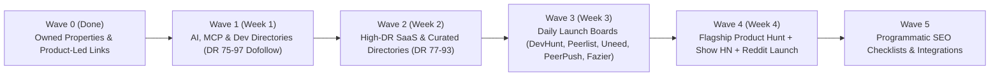

# Waitlyze Master GTM Launch, Directory Backlink & SEO Playbook

> [!IMPORTANT]
> **Strategic Goal:** Grow **Waitlyze** (`https://waitlyze.com`) from `DR 1.3` (`1% dofollow` across 141 linking domains) to `DR 35+` and rank **#1 on Google & AI Search** for waitlist builder, referral waitlist, and competitor alternative queries, while executing a multi-wave launch across every high-ROI launch board, developer community, AI/MCP registry, and SaaS directory.
>
> **GitHub Epic:** [#255](https://github.com/FALAK097/waitlyze/issues/255)

---

## 1. Competitive Teardown: How LaunchList & BuiltByIndies Acquire Traffic & Links

From analyzing reference pages (`getlaunchlist.com/directories`, `builtbyindies.com/launch-directories`, `getlaunchlist.com/blog/product-launch-tools`, and the 4 launch checklists), here is what they are doing and why it works:

1. **Programmatic "Free Founder Resources" as Top-of-Funnel Magnets:**
   - LaunchList doesn't just blog about waitlists - they built `/directories` (1,125 checked launch places with filters for `start-here`, `free-dofollow`, `before-you-launch`) and `/checklists` (`/checklists/producthunt`, `/checklists/saas-launch`, `/checklists/pre-launch-marketing`), plus `/blog/product-launch-tools` ("25 Best Product Launch Tools Organized by Stage").
   - Every founder preparing a launch searches _"where to launch my startup"_, _"free dofollow directories"_, _"Product Hunt launch checklist"_, or _"SaaS launch checklist"_ **2-6 weeks before launch** - the exact moment they need a waitlist tool.
2. **Waitlyze's Unfair Product Advantages Over LaunchList & GetWaitlist:**
   - **Native Streamable HTTP MCP Server (`/mcp` & `/docs/mcp`) + OpenAI App Plugin:** Neither LaunchList nor GetWaitlist has a native MCP server or ChatGPT app integration. This qualifies Waitlyze for **DR 75-92 dofollow AI & MCP registries** (`Docker MCP Catalog`, `Official MCP Registry`, `Smithery`, `Claude Plugin Directory`, `Glama`, `PulseMCP`).
   - **Self-Hosted Visual Page Builder + 14 Industry Templates + Custom Domains:** Hosted `/w/[slug]` pages, custom domains, and `/js/embed.js` widgets all carry **dofollow** attribution back to `https://waitlyze.com`.
   - **BYO Resend Sender + Double Opt-In + Fraud Velocity Protection:** Verified referral credit (only confirmed emails count toward queue rank/milestones) solves the #1 complaint founders have with viral waitlists.

---

## 2. Copy-Paste Master Submission Kit (Prepare Once, Paste Everywhere)

Both `builtbyindies.com/launch-directories` and `getlaunchlist.com/directories` emphasize rule #1: **prepare your canonical assets once** with identical naming, tagline, and descriptions so every listing reinforces the same brand entity across the web.

| Asset Field                        | Canonical Copy for Waitlyze                                                                                                                                                                                                                                                                                                                                                                                                                                                                                                                                                                                   |
| :--------------------------------- | :------------------------------------------------------------------------------------------------------------------------------------------------------------------------------------------------------------------------------------------------------------------------------------------------------------------------------------------------------------------------------------------------------------------------------------------------------------------------------------------------------------------------------------------------------------------------------------------------------------ |
| **Product Name**                   | `Waitlyze`                                                                                                                                                                                                                                                                                                                                                                                                                                                                                                                                                                                                    |
| **Canonical URL**                  | `https://waitlyze.com`                                                                                                                                                                                                                                                                                                                                                                                                                                                                                                                                                                                        |
| **One-Line Tagline (<= 60 chars)** | `Waitlist builder with verified referrals, emails & MCP`                                                                                                                                                                                                                                                                                                                                                                                                                                                                                                                                                      |
| **Short Pitch (<= 160 chars)**     | `Build a branded waitlist page or embed widget, grow signups with verified referral loops, send automated launch emails via Resend, and manage via API or MCP.`                                                                                                                                                                                                                                                                                                                                                                                                                                               |
| **Long Description (Copy-Paste)**  | `Waitlyze is an all-in-one pre-launch waitlist platform for founders, developers, and product teams. Pick from 14 launch templates or drop a 2-line embed widget into Next.js, Framer, or Webflow. Every signup gets double opt-in verification and a personal referral link with fraud-protected queue ranking, milestone rewards, and live leaderboards. Connect your own custom domain and Resend sender to run welcome automations and launch-day broadcasts, or manage your waitlists directly from Cursor, Claude, and ChatGPT via Waitlyze's native Model Context Protocol (MCP) server and REST API.` |
| **Primary Categories**             | `SaaS` · `Developer Tools` · `Marketing & Growth` · `Waitlist Software` · `MCP Servers / AI Tools`                                                                                                                                                                                                                                                                                                                                                                                                                                                                                                            |
| **Pricing Model**                  | `Freemium (Free tier: 1 workspace, 1 waitlist, 100 signups; Pro: $15/mo or $119/yr unlimited)`                                                                                                                                                                                                                                                                                                                                                                                                                                                                                                                |
| **Founder / Maker**                | `Falak Gala` (`https://falakgala.dev` · `https://x.com/FalakGala097` · `https://github.com/FALAK097/waitlyze`)                                                                                                                                                                                                                                                                                                                                                                                                                                                                                                |
| **Visual Assets to Attach**        | 1. Square Logo: `public/web-app-manifest-512x512.png` 2. Social Cover (`1200x630`): `https://waitlyze.com/opengraph-image` 3. Product Demo Video: Hero launch film (`waitlyze-launch.mp4`) 4. 4 Screenshots: Page Builder, Referral Cockpit & Leaderboard, Email Automations, Analytics + MCP Integration                                                                                                                                                                                                                                                                                            |

---

## 3. Multi-Wave Platform & Directory Launch Plan (Ranked by DR, Dofollow & Traffic)

Following the methodology from `getlaunchlist.com/directories` and `builtbyindies.com/launch-directories`: **never blast 100 directories in one day.** Space launches into waves over 4 weeks so each launch board gets full attention for comments, and Google sees steady, natural `dofollow` link velocity from high-DR domains.

### Wave 0: Owned Properties & Product-Led Backlink Engine (Completed)

- [x] **Google Search Console MCP Setup & Full Sitemap Audit (84 Clean URLs):** Configured `gscServer`, submitted `https://waitlyze.com/sitemap.xml`, pruned 18 thin blog tag pages (`<3` posts) from sitemap with `noindex, follow`.
- [x] **On-Page SEO Fixes & Automated IndexNow CI Pipeline (`1c439770`, `a0f20c38`):** Fixed truncated `<title>` tags, expanded 22 short docs meta descriptions, fixed duplicate `<h1>` tags across all 14 `/templates/[id]` pages, lifted `/templates/simple` & `/templates/blank` above 300 words, added `/support` footer link, enriched `Organization` JSON-LD, and automated IndexNow via `.github/workflows/seo-indexnow.yml`.
- [x] **`falakgala.dev` & `falakgala.dev/projects` -> `waitlyze.com`:** Verified live with clean **dofollow** `<a href="https://waitlyze.com" target="_blank" rel="noreferrer">Waitlyze</a>` links; both pages are `Submitted and indexed` in Google Search Console.
- [x] **Hosted & Custom Domain Badge (`WaitlistPageContent`):** Renders a **dofollow** `Powered by Waitlyze` link (`href="https://waitlyze.com"`) on public `/w/[slug]` and custom-domain waitlist pages.
- [x] **Drop-in Embed Snippet (`publish-and-share.jsx`, `embed.js`, `docs/embed.mdx`, `agent-instructions.md`, `llms-full.txt`):** Includes a crawlable **dofollow** `<a href="https://waitlyze.com" target="_blank" rel="noopener">Waitlist powered by Waitlyze</a>` fallback link inside `
` that crawlers index in static HTML and `embed.js` seamlessly replaces with the live iframe on mount.
- [x] **HTML Counter & Leaderboard Widgets (`/api/widgets/*`):** Include `Powered by Waitlyze` attribution links.

### Wave 1 (Week 1): High-DR Free Dofollow Developer, MCP & AI Directories (DR 75-97)

_Why first:_ These have the highest Domain Rating, require zero upvote campaigns, give permanent **dofollow** links, and play directly to Waitlyze's `/mcp` + developer API moat.

| Issue                                                   | Platform / Directory                                   |    DR     |     Link Type      | Cost | Submission Angle for Waitlyze                                                                                          |
| :------------------------------------------------------ | :----------------------------------------------------- | :-------: | :----------------: | :--: | :--------------------------------------------------------------------------------------------------------------------- |
| [#256](https://github.com/FALAK097/waitlyze/issues/256) | **Docker MCP Catalog**                                 |  **92**   |    **Dofollow**    | Free | Submit Waitlyze's Streamable HTTP MCP server (`https://waitlyze.com/mcp`, docs at `/docs/mcp`).                        |
| [#257](https://github.com/FALAK097/waitlyze/issues/257) | **MCP Registry** (`modelcontextprotocol.io` / GitHub)  |  **91**   |    **Dofollow**    | Free | Register `waitlyze` MCP server; syndicates across dozens of MCP web directories.                                       |
| [#258](https://github.com/FALAK097/waitlyze/issues/258) | **Claude Plugin / MCP Directory**                      |  **90+**  |    **Dofollow**    | Free | Listed on `getlaunchlist.com/directories/free-dofollow/claude-plugins` as verified free + dofollow.                    |
| [#259](https://github.com/FALAK097/waitlyze/issues/259) | **Smithery.ai, Glama.ai, PulseMCP & Cursor Directory** | **75-79** |    **Dofollow**    | Free | List Waitlyze MCP server for AI agents managing waitlists, subscribers & analytics.                                    |
| [#260](https://github.com/FALAK097/waitlyze/issues/260) | **GitHub Showcase & Topics** (`FALAK097/waitlyze`)     |  **97**   | Nofollow / Traffic | Free | Ensure repo homepage URL is set to `https://waitlyze.com` with topics `waitlist`, `nextjs`, `mcp`, `referral-program`. |

### Wave 2 (Week 2): High-DR Evergreen SaaS, Comparison & Curated Directories (DR 77-93)

_Why second:_ Software buyers and LLMs (ChatGPT, Perplexity, Gemini) heavily cite these comparison and review sites when answering _"best waitlist software"_.

| Issue                                                   | Platform / Directory                                             |    DR     |       Link Type        | Cost | Action Item                                                                                                                                                                                         |
| :------------------------------------------------------ | :--------------------------------------------------------------- | :-------: | :--------------------: | :--: | :-------------------------------------------------------------------------------------------------------------------------------------------------------------------------------------------------- |
| [#261](https://github.com/FALAK097/waitlyze/issues/261) | **SourceForge**                                                  |  **93**   |      **Dofollow**      | Free | Create vendor listing under Pre-Launch / Referral Marketing Software.                                                                                                                               |
| [#262](https://github.com/FALAK097/waitlyze/issues/262) | **Gartner Digital Markets (Capterra / GetApp)**                  |  **92**   |      **Dofollow**      | Free | Submit vendor application for Campaign & Referral Management software.                                                                                                                              |
| [#263](https://github.com/FALAK097/waitlyze/issues/263) | **G2**                                                           |  **91**   |      **Dofollow**      | Free | Claim free vendor profile (`waitlyze.com`); invite first 5 active users to leave verified reviews.                                                                                                  |
| [#264](https://github.com/FALAK097/waitlyze/issues/264) | **AlternativeTo & SaaSHub** (`alternativeto.net`, `saashub.com`) | **77-86** | Dofollow / High Intent | Free | Add Waitlyze and tag it as an alternative to **GetWaitlist**, **LaunchList**, **Viral Loops**, **KickoffLabs**, **Prefinery**, and **Waitlister**.                                                  |
| [#265](https://github.com/FALAK097/waitlyze/issues/265) | **Zumvu / Findly.tools / ToolPilot / Dang.ai**                   | **79-83** |      **Dofollow**      | Free | Verified on `getlaunchlist.com/directories/free-dofollow` and `builtbyindies.com` as active free dofollow directories.                                                                              |
| [#266](https://github.com/FALAK097/waitlyze/issues/266) | **TinyShelf** (`https://www.tinyshelf.co/`)                      |  Curated  |   Directory Listing    | Free | Submit at `https://www.tinyshelf.co/submit` under `Marketing & Sales` / `Developer Tools` with logo, canonical pitch, tags (`#saas`, `#freemium`, `#developer-tools`), and 3-4 product screenshots. |

### Wave 3 (Week 3): Curated Launch Boards (1 Board Per Day - Warm Up Before Product Hunt)

_Why third:_ From `getlaunchlist.com/directories/start-here` and `free-dofollow`, these boards rank daily launches by votes and award **dofollow** links. Space them across Tuesday-Friday so you can reply to every comment on the day you go live.

| Issue                                                   |     Day      | Launch Board                                                                                          |    DR     |  Link Type   | Badge Rule / Notes                                                                                                                                  |
| :------------------------------------------------------ | :----------: | :---------------------------------------------------------------------------------------------------- | :-------: | :----------: | :-------------------------------------------------------------------------------------------------------------------------------------------------- |
| [#267](https://github.com/FALAK097/waitlyze/issues/267) | **Tue (W3)** | **Dev Hunt** (`devhunt.org`)                                                                          |  **76+**  | **Dofollow** | Verified **Free + Dofollow** across all 6 checked listings. Frame around Developer Signup API + Webhooks + MCP.                                     |
| [#268](https://github.com/FALAK097/waitlyze/issues/268) | **Wed (W3)** | **Peerlist Launchpad** (`peerlist.io`)                                                                |  **78**   | **Dofollow** | Weekly launchpad where your existing engineering network is active. Launch early in the week.                                                       |
| [#269](https://github.com/FALAK097/waitlyze/issues/269) | **Thu (W3)** | **Uneed** (`uneed.best`)                                                                              |  **76**   | **Dofollow** | Core "Start Here" board. High indie founder traffic.                                                                                                |
| [#270](https://github.com/FALAK097/waitlyze/issues/270) | **Fri (W3)** | **PeerPush** (`peerpush.net`)                                                                         |  **79**   | **Dofollow** | Verified active and free + dofollow in both `builtbyindies.com` and `getlaunchlist.com`.                                                            |
| [#271](https://github.com/FALAK097/waitlyze/issues/271) | **Mon (W4)** | **Fazier** (DR 85), **Startup Fame** (DR 84), **Turbo0** (DR 81), **BetaList** (DR 77) & Bonus Boards | **70-85** | **Dofollow** | Submit BetaList free queue 2-4 weeks ahead; run Fazier, Startup Fame, Turbo0, OpenHunts, TinyLaunch, Microlaunch, CodeHype, DeepLaunch, MaidenSail. |

---

## 4. Wave 4 (Week 4): Flagship Launch Playbooks

### A. Product Hunt Launch Checklist ([#272](https://github.com/FALAK097/waitlyze/issues/272) & [#273](https://github.com/FALAK097/waitlyze/issues/273))

#### Phase 1: 14 Days Before Launch (Preparation - [#272](https://github.com/FALAK097/waitlyze/issues/272))

- [ ] **Warm up PH profile:** Update `@FalakGala` on Product Hunt with bio, X (`@FalakGala097`), and `https://waitlyze.com`. Comment genuinely on 2-3 launches per day for 2 weeks prior.
- [ ] **Self-hunt vs. Hunter:** Self-hunting is recommended by Product Hunt in 2026 (makers get full scheduling control).
- [ ] **Prepare PH Listing Assets:**
  - **Title:** `Waitlyze`
  - **Tagline (60 chars):** `Launch branded waitlists with verified referrals, email & MCP`
  - **Topics:** `SaaS`, `Developer Tools`, `Marketing`, `Artificial Intelligence`
  - **Thumbnail:** `240x240` high-contrast animated GIF or crisp Waitlyze mark.
  - **Gallery (5 slides + 1 video):**
    1. Hero launch video (`waitlyze-launch.mp4` / YouTube embed)
    2. Visual Page Builder & 14 Templates
    3. Verified Referral Loop, Queue Position & Fraud Protection
    4. BYO Resend Email Automations & Broadcasts
    5. Native MCP Server (`Cursor` / `Claude` / `ChatGPT` managing a live waitlist)
- [ ] **Launch Promo Offer:** Create a Product Hunt exclusive promo (e.g., `PHLAUNCH` - 30% off Waitlyze Pro first year) and mention it in the Maker Comment.
- [ ] **Draft the Maker's First Comment (Post at 00:01 PST):**
  - _Problem:_ Most waitlist tools either charge $99+/mo just to remove branding, count fake bot emails as referrals, or trap your email sender on a shared domain.
  - _What we built:_ Waitlyze - 14 templates, verified double-opt-in referral loops, BYO Resend domain email automations, custom domains, and the first waitlist platform with a native MCP server (`/mcp`).
  - _Ask:_ Invite founders to test the live interactive builder and share feedback.

#### Phase 2: Launch Day Hour-by-Hour Schedule (Tuesday or Wednesday, 12:01 AM PST / 12:31 PM IST - [#273](https://github.com/FALAK097/waitlyze/issues/273))

- [ ] **12:01 AM PST (12:31 PM IST):** Go live on Product Hunt + post Maker's First Comment immediately.
- [ ] **12:15 AM PST (12:45 PM IST):** Publish X/Twitter launch thread (with `waitlyze-launch` video attached natively) + LinkedIn post.
- [ ] **1:00 AM PST (1:30 PM IST):** Send broadcast email to existing Waitlyze users/subscribers announcing the PH launch (ask for honest feedback/reviews on the conversation, never ask for raw "upvotes").
- [ ] **6:00 AM - 12:00 PM PST (6:30 PM - 12:30 AM IST - US Morning Peak):** Reply to **every single comment within 10 minutes** (comment velocity weights heavily in PH's ranking algorithm). Post a mid-day build-in-public update on X and Indie Hackers.
- [ ] **Post-Launch (48h later):** Publish a transparent launch recap blog post on `waitlyze.com/blog` and Indie Hackers with real traffic, signup, and conversion numbers.

---

### B. Hacker News (`Show HN`) & Reddit Launch Playbook ([#274](https://github.com/FALAK097/waitlyze/issues/274))

- [ ] **Show HN Title (Plain, technical, zero marketing fluff):**
      `Show HN: Waitlyze - Waitlist builder with verified referrals, BYO Resend, and MCP`
- [ ] **Show HN Body / First Comment:**
  - Lead with the **engineering architecture**: Next.js App Router on Cloudflare Workers (OpenNext), Cloudflare D1 + Prisma, double-opt-in referral fraud velocity checks, and Streamable HTTP Model Context Protocol (`/mcp`) with OAuth 2.1 DCR.
  - Make sure readers can test a live demo template (`/templates/developer` or `/templates/saas`) or free Launch Lab tool (`/tools`) **without** creating an account first.
- [ ] **Reddit Communities (Space 2-3 days apart, native story format):**
  - `r/SideProject` - Show the product tour video + how you built the referral verification and MCP server.
  - `r/indiehackers` & `r/SaaS` - Share the data from your robots.txt / AI SEO analysis or the engineering behind stopping fake referral signups.
  - `r/nextjs` - Share the OpenNext + Cloudflare Workers + D1 + dynamic OG / JSON-LD architecture.

---

## 5. Wave 5: Next Programmatic SEO Pages on `waitlyze.com` ([#275](https://github.com/FALAK097/waitlyze/issues/275) & [#276](https://github.com/FALAK097/waitlyze/issues/276))

1. **Interactive Launch Checklists & Curated Directory Hub ([#275](https://github.com/FALAK097/waitlyze/issues/275)):**
   - _Product Hunt Launch Checklist 2026_
   - _SaaS Pre-Launch Marketing Checklist_
   - _Indie Hacker Launch Directory List (Curated Dofollow + AI/MCP Directories)_
   - Complements [#241](https://github.com/FALAK097/waitlyze/issues/241) (`/tools/product-launch-checklist`).
2. **Platform Integration Landing Pages ([#276](https://github.com/FALAK097/waitlyze/issues/276)):**
   - Dedicated landing pages for _"Waitlist for Framer"_, _"Waitlist for Webflow"_, _"Waitlist for Next.js"_, _"Waitlist for Carrd"_, and _"Waitlist for WordPress"_ showcasing the 2-line `/js/embed.js` snippet and React server action examples.
   - Cross-linked with [#239](https://github.com/FALAK097/waitlyze/issues/239) (`/tools/viral-coefficient-calculator`) and [#248](https://github.com/FALAK097/waitlyze/issues/248) (`/tools/waitlist-embed-generator`).
